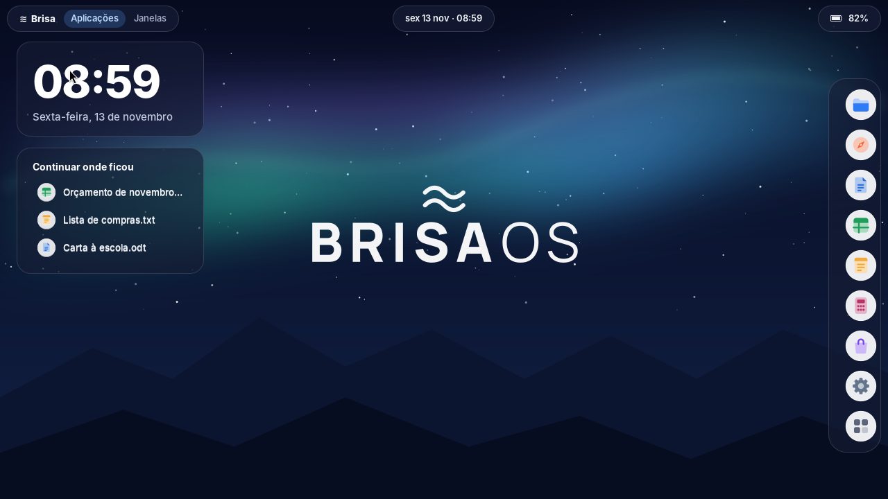
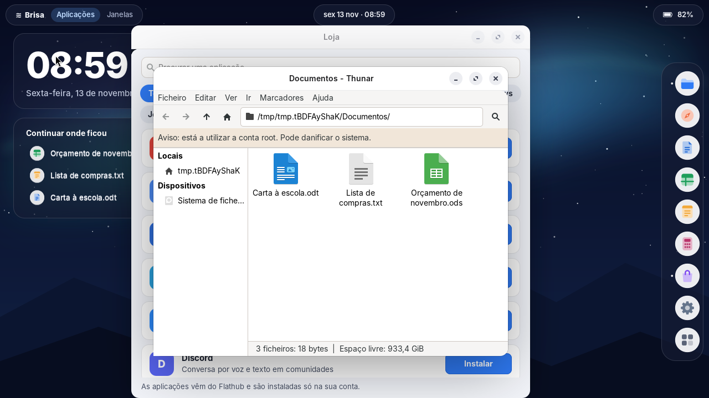
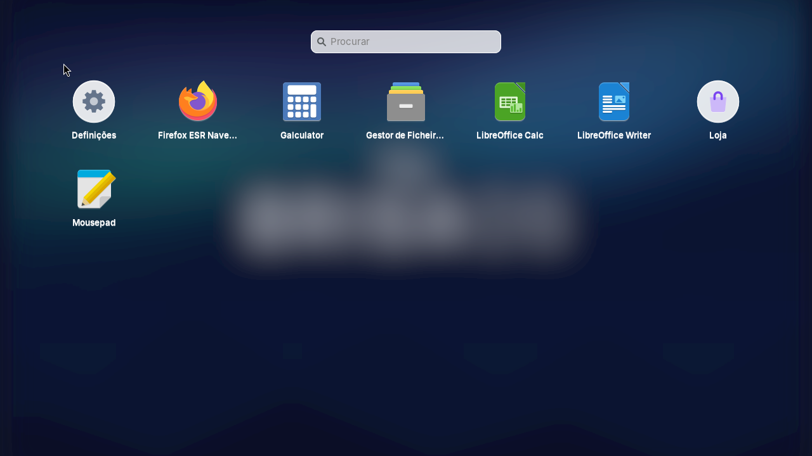
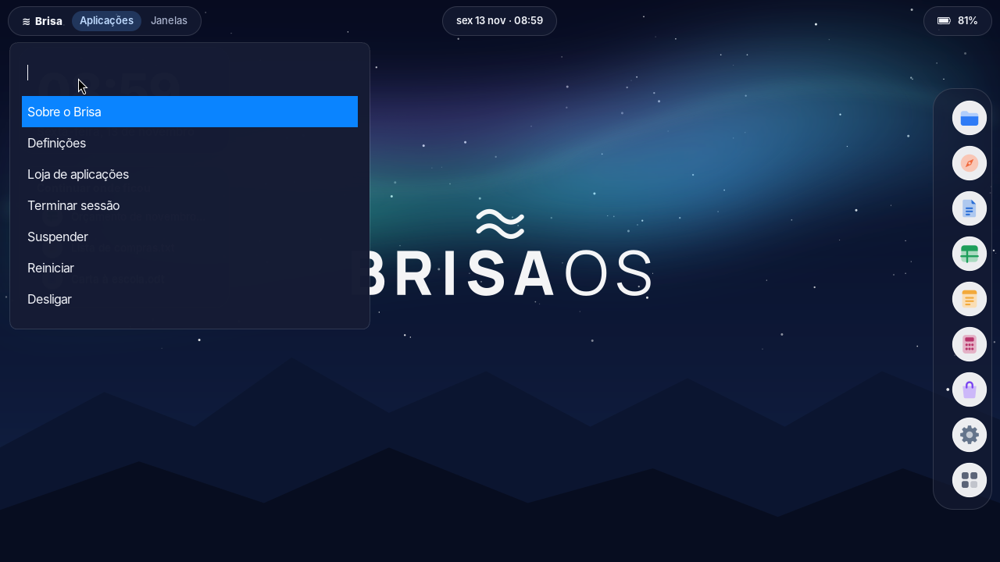

# Brisa OS

Um sistema operativo leve e bonito, em português, para dar nova vida a computadores com pouca memória.
Tem o Office incluído, uma loja de aplicações simples e abre muitos programas do Windows.



O Brisa é uma distribuição baseada no **Debian 13**, com um ambiente de trabalho próprio construído sobre o
compositor **Wayfire**. Arranca a partir de uma pen USB ou de uma máquina virtual, e instala-se no disco
com um instalador gráfico.

## Transferir

A imagem de instalação (`brisa-1.0.iso`, cerca de 1,6 GB) está na página
[Releases](../../releases) deste repositório.

## O que traz

- **Layout Ilhas**: três ilhas escuras e translúcidas em cima (menu, data e hora, rede, som e bateria)
  e uma doca vertical à direita, com um ponto ao lado das aplicações abertas.
- **Widgets no ambiente de trabalho**: um relógio grande e "Continuar onde ficou", com os últimos
  ficheiros abertos.
- **Ecrã de Aplicações** em grelha, ao estilo Launchpad, com pesquisa. Fecha ao clicar fora.
- **Office incluído**: LibreOffice Writer (documentos, como o Word), Calc (folhas de cálculo, como o
  Excel) e Impress (apresentações), com atalhos na doca.
- **Navegador** Firefox, gestor de ficheiros, notas, calculadora, leitor de PDF, imagens e vídeo.
- **Programas do Windows**: o Wine vem instalado e um duplo clique num `.exe` ou `.msi` abre-o.
- **Loja**: um catálogo escolhido (Chrome, Telegram, Zoom, Spotify, VS Code, Steam e outros), que mostra
  o tamanho antes de instalar, o progresso em MB e um botão Cancelar. As aplicações vêm do Flathub e
  instalam-se sem palavra-passe.
- **Definições** próprias: idioma (português de Portugal, português do Brasil ou inglês), teclado, fundo
  de ecrã (seis fundos com o nome do sistema) e animações.
- **Feito para máquinas fracas**: swap comprimido em memória, sem serviços desnecessários em segundo
  plano, e animações curtas que se podem desligar.

| Janelas abertas | Ecrã de Aplicações |
|---|---|
|  |  |

| Menu do sistema | Sessão de instalação |
|---|---|
|  |  |

## Requisitos

- Processador de 64 bits (x86-64).
- 2 GB de memória (4 GB recomendados).
- 10 GB de disco para instalar (25 GB recomendados).

## Experimentar e instalar

### Numa pen USB

1. Transfere `brisa-1.0.iso` da página Releases.
2. Grava-a numa pen de 4 GB ou mais com o [Rufus](https://rufus.ie) (Windows) ou o
   [balenaEtcher](https://etcher.balena.io). Tudo o que estiver na pen é apagado. Se o Rufus perguntar o
   modo de gravação, escolhe **modo de imagem DD**.
3. Arranca o computador pela pen (normalmente F12, F9 ou Esc ao ligar).
4. O Brisa abre em **modo de experimentação**, sem tocar no disco, e o instalador aparece sozinho.
   Se o fechares, podes voltar a abri-lo pelo botão azul "Instalar o Brisa".

Se o computador tiver o Secure Boot ligado e recusar arrancar, desliga-o na configuração da BIOS.

### Numa máquina virtual (VirtualBox)

- Tipo **Linux**, versão **Debian (64-bit)**.
- Marca **Skip Unattended Installation** (sem isto, o VirtualBox tenta instalar sozinho e falha).
- 4096 MB de memória e 2 processadores.
- Em Display: controlador **VMSVGA**, **128 MB** de memória de vídeo e **aceleração 3D** ligada.
  Sem a aceleração 3D o ambiente de trabalho não arranca.
- Disco de 25 GB.

### A instalação

O instalador pede o idioma, o fuso horário, o teclado, onde instalar (apagar o disco inteiro, ao lado de
outro sistema, ou partições à mão) e o teu nome de utilizador e palavra-passe. Depois de reiniciar, retira
a pen (ou a ISO, na máquina virtual) e entra com a conta que criaste.

Na sessão de experimentação a conta é `brisa` com a palavra-passe `live`. Essa conta não existe no sistema
instalado.

## Programas do Windows: o que esperar

O Wine corre muitos programas do Windows, mas não todos. Programas recentes com proteções fortes
(Microsoft 365 de secretária, Adobe, alguns jogos com anti-batota) normalmente não funcionam.

Um `.exe` corre com as permissões da tua conta: pode ler e alterar os teus ficheiros pessoais, mas não o
sistema. Abre só programas de fontes em que confias. Para mais isolamento, usa o **Bottles**, disponível
na Loja.

## Estado do projeto

Esta é a versão 1.0 de um projeto pessoal. O ambiente de trabalho foi testado num ecrã virtual e as
versões anteriores numa máquina virtual. A instalação completa da 1.0 em hardware real ainda não foi
testada.

**Limitações conhecidas**

- O menu que aparece logo ao arrancar a pen ainda mostra o aspeto do Debian.
- Em modo de experimentação o espaço para instalar aplicações é a memória do computador, por isso
  aplicações grandes (como o Chrome, com cerca de 1,5 GB) só se instalam depois de instalar o Brisa no disco.
- Numa máquina virtual o ambiente fica mais lento do que num computador real, sobretudo se o Windows
  tiver o Hyper-V ligado (o que acontece quando o WSL ou o Docker estão instalados).

## Como está organizado

```
sistema/
  construir.sh            constrói a ISO
  live/                   receita da imagem (live-build)
    auto/config           opções da imagem: Debian 13, amd64, ISO híbrida
    config/package-lists/ pacotes incluídos
    config/hooks/         ajustes feitos dentro da imagem durante a construção
    config/includes.chroot/
      usr/local/bin/      programas do Brisa (ver abaixo)
      usr/share/brisa/    ícones e fundos de ecrã (SVG)
      etc/skel/.config/   configuração predefinida: Wayfire, Waybar, GTK, Fuzzel, Mako, Foot
      etc/calamares/      instalador com a marca Brisa
      etc/lightdm/        ecrã de início de sessão
  ferramentas/            geradores de gráficos, testes e utilitários de construção
  layouts/                maquetas em HTML dos layouts, ícones e fundos estudados
  anuncios/               imagens de anúncio
prototipo-web/            primeiro protótipo do ambiente de trabalho, em HTML
docs/imagens/             capturas de ecrã deste README
```

### Programas do Brisa

| Programa | O que faz |
|---|---|
| `brisa-sessao` | Arranca a sessão gráfica (Wayfire), com o idioma e o teclado escolhidos. |
| `brisa-barras` | Arranca as ilhas e a doca (Waybar) no idioma da sessão; sem doca na sessão de instalação. |
| `brisa-widgets` | Relógio e ficheiros recentes no ambiente de trabalho. |
| `brisa-apps` | Ecrã de Aplicações em grelha, com pesquisa. |
| `brisa-loja` | Loja de aplicações (Flathub). |
| `brisa-definicoes` | Idioma, teclado, fundo e animações. |
| `brisa-menu` | Menu do sistema: sobre, definições, terminar sessão, desligar. |
| `brisa-instalar` | Abre o instalador (Calamares) na sessão de experimentação. |
| `brisa-janelas` | Mostra todas as janelas abertas. |
| `brisa-abrir`, `brisa-doca-estado` | Abrir ou trazer para a frente uma aplicação da doca, e mostrar o ponto de "aberta". |
| `brisa-fundo` | Mostra o fundo de ecrã escolhido. |

## Construir a ISO

É preciso um sistema Linux (ou o WSL 2 no Windows) com acesso de administrador e Internet.

1. Cria um ambiente Debian 13 em `/opt/brisa/trixie`:

   ```bash
   sudo debootstrap --variant=minbase --include=ca-certificates trixie /opt/brisa/trixie http://deb.debian.org/debian
   ```

2. Instala dentro dele as ferramentas de construção:

   ```bash
   sudo bash sistema/ferramentas/entrar.sh bash -c "apt-get update && apt-get install -y live-build"
   ```

3. Constrói a imagem (demora 20 a 40 minutos e transfere cerca de 2 GB):

   ```bash
   sudo bash sistema/construir.sh
   ```

   A ISO fica em `/opt/brisa/saida/brisa.iso`.

Os ícones e a imagem do instalador geram-se com `python sistema/ferramentas/gerar-graficos.py`, e os fundos com
`python sistema/ferramentas/gerar-fundos-opcoes.py sistema/layouts`.

## Construído com

[Debian](https://www.debian.org), [Wayfire](https://wayfire.org), [Waybar](https://github.com/Alexays/Waybar),
[Fuzzel](https://codeberg.org/dnkl/fuzzel), [Calamares](https://calamares.io), [LibreOffice](https://www.libreoffice.org),
[Firefox](https://www.mozilla.org/firefox), [Wine](https://www.winehq.org), [Flatpak](https://flatpak.org) e
[Flathub](https://flathub.org), com as letras [Inter](https://rsms.me/inter) e [Manrope](https://manropefont.com).
